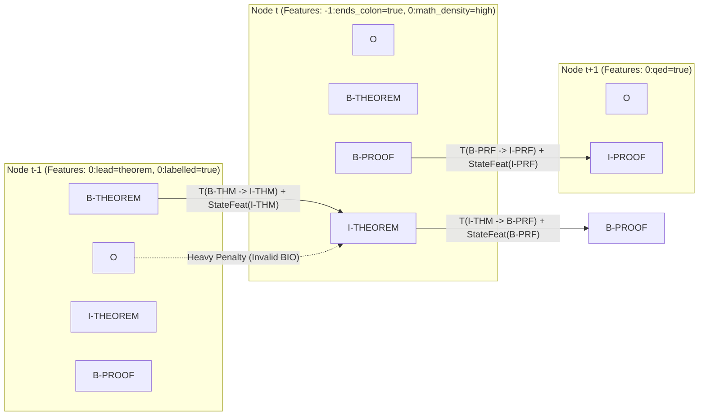

# Mathia System Architecture & Technical Specification

Mathia is a high-performance, deterministic compiler and desktop study guide application. It transforms raw, OCR-transcribed Markdown and LaTeX documents (Persian, English, or mixed bilingual) or imported HTML files into single, self-contained, interactive HTML study guides. It can also standardize and repair OCR transcription errors or convert compiled documents back into structured Markdown.

This document serves as the authoritative architectural blueprint for both human engineers and AI coding agents navigating, modifying, or extending the codebase.

---

## 1. System Overview & Invariants

Mathia is designed around strict architectural invariants to guarantee determinism, zero-dependency deployment, and client-side security:

1. **Pure, Deterministic Core ([`crates/math-core`](../crates/math-core/src/lib.rs))**:
   - The core compilation engine contains **no network calls, no asynchronous runtimes, no local server daemons, and no direct LLM integrations**.
   - Identical inputs with the same configuration always yield byte-identical abstract structures.
   - External decision models interact exclusively through explicit, optional trait boundaries ([`BlockJudge`](../crates/math-core/src/classifier.rs)).
2. **Zero-Inference Runtime Bloat**:
   - Machine learning is applied via a Linear-Chain Conditional Random Field (CRF) implemented in pure Rust ([`crates/math-core/src/crf.rs`](../crates/math-core/src/crf.rs)) and trained offline in Python ([`ml/src/mathia_ml/train_crf.py`](../ml/src/mathia_ml/train_crf.py)).
   - Ingestion and inference run 100% in pure Rust using Viterbi dynamic programming. Model weights ([`crf_weights.json`](../crates/math-core/src/crf_weights.json), ~50 KB) are embedded at compile time using `include_str!`.
   - The desktop app bundles no ONNX runtime, no Python runtime, no PyTorch binaries, and no local LLM weights.
3. **Hard Security & Isolation Boundary**:
   - Compiled HTML study guides enforce a strict Content Security Policy (CSP) generated in [`crates/math-core/src/html.rs`](../crates/math-core/src/html.rs). Only scripts embedded by Mathia itself are permitted, matched via SHA-256 hashes (`'sha256-...'`) computed with the zero-dependency SHA-256 implementation in [`crates/math-core/src/sha256.rs`](../crates/math-core/src/sha256.rs).
   - Network access is blocked by default (`connect-src 'none'`). When `--ai` features are explicitly requested, `connect-src` is strictly scoped to designated provider origins.
   - Interactive LLM interactions (Ask & Illustrate) occur purely client-side in the reader's browser via [`crates/math-core/assets/ai.js`](../crates/math-core/assets/ai.js). API keys are stored in the client browser's `localStorage` and are never embedded into compiled files or sent to Mathia binaries.
4. **Resilient Edit Invariance**:
   - User overrides and model corrections do not bind to volatile absolute line numbers or raw node array indices.
   - Overrides bind via 64-bit content-anchored hashes ([`ContentAnchor`](../crates/math-core/src/classifier.rs): hash of normalized text + occurrence index via [`compute_node_anchor`](../crates/math-core/src/classifier.rs)), allowing manual annotations to survive upstream document editing.

---

## 2. Component & Layer Architecture

The repository is structured into four primary layers, plus an offline dev-time ML workspace:

```text
                               ┌────────────────────────────────────────────────┐
                               │           Desktop UI Layer                     │
                               │  src-tauri (Tauri v2) + ui/ (HTML5/CSS3/ES6)   │
                               │  - Custom URI Scheme: mathia-preview://        │
                               │  - IPC Commands: analyze, compile, export, fix │
                               └───────────────────────┬────────────────────────┘
                                                       │
                               ┌───────────────────────▼────────────────────────┐
                               │             CLI Front-End                      │
                               │           crates/mathia-cli                    │
                               │  - CLI flags, watch mode, feature dumper       │
                               └───────────────────────┬────────────────────────┘
                                                       │
                           ┌───────────────────────────┴───────────────────────────┐
                           │                                                       │
┌──────────────────────────▼─────────────────────────┐         ┌───────────────────▼──────────────────┐
│             Decision Model Judge Seam              │         │            Pure Core Engine          │
│                crates/math-judge                   │         │            crates/math-core          │
│  - Trait BlockJudge implementation                 │         │  - Normalization & OCR repair        │
│  - Stdio JSON-Lines Subprocess (CommandJudge)      │◄───────►│  - AST Parser (pulldown-cmark)       │
│  - REST API Client (ApiJudge: Jev, Claude, OpenAI) │ (seam)  │  - Static Feature Extraction         │
│  - SHA-256 Content-Keyed Cache (CachedJudge)       │         │  - SequenceTagger (Heuristic / CRF)  │
│  - Replay Logs & Override Generation               │         │  - HTML5 & Markdown Compilers        │
└────────────────────────────────────────────────────┘         └───────────────────▲──────────────────┘
                                                                                   │
                                                                                   │ embedded weights
                                                                                   │ (compile-time)
                                                               ┌───────────────────┴──────────────────┐
                                                               │       Dev-Only ML Flywheel           │
                                                               │         ml/ (Python + uv)            │
                                                               │  - Synthetic OCR dataset generator   │
                                                               │  - sklearn-crfsuite (L-BFGS + L1/L2) │
                                                               │  - seqeval exact-span F1 benchmark   │
                                                               │  - Exports crf_weights.json          │
                                                               └──────────────────────────────────────┘
```

### End-to-End Data Flow

The complete compilation pipeline processes input text through deterministic transformation phases:

```mermaid
flowchart TD
    In["Raw Input (Markdown / LaTeX or HTML)"] --> CleanCheck{"HTML or MD?"}
    
    %% HTML Path
    CleanCheck -- "HTML" --> HTMLClean["clean_html::clean_html() / analyze_html_detailed()"]
    HTMLClean --> ASTClean["DOM Parser & Sanitizer (html5ever / regex)"]
    
    %% Markdown Path
    CleanCheck -- "Markdown" --> Norm["normalize::normalize_markdown() & repair::wrap_bare_math()"]
    Norm --> Parse["parser::parse_markdown()"]
    Parse --> AST["Flat AST Top-Level Nodes (Vec<Node>)"]
    
    ASTClean --> AST
    
    %% Feature & Tagging
    AST --> Feat["features::Lexicon::extract() -> Vec<NodeFeatures>"]
    Feat --> CrfTag["crf::CrfTagger::decode_nodes() (Viterbi Trellis)"]

    CrfTag --> BioTags["BIO Sequence Tags (Vec<TaggedNode>)"]

    BioTags --> TagsToBlocks["classifier::BlockClassifier::tags_to_blocks()"]
    
    %% Overrides & Judge
    TagsToBlocks --> Overrides["classifier::ScopeOverrides::resolve() (ContentAnchor)"]
    Overrides --> JudgeCheck{"Judge configured & Low Confidence?"}
    
    JudgeCheck -- "No / High Confidence" --> Doc["model::Document::new(nodes, blocks)"]
    JudgeCheck -- "Yes (Escalate)" --> JudgeRun["math_judge::BlockJudge::judge_batch()"]
    JudgeRun --> CacheLookup{"Cached in CachedJudge?"}
    CacheLookup -- "Hit" --> ApplyVerdict["Apply Verdict (Retype / EndAt / Reject)"]
    CacheLookup -- "Miss" --> ExecJudge["CommandJudge (stdio) / ApiJudge (REST)"]
    ExecJudge --> RecordCache["Write to CachedJudge & Replay Log"]
    RecordCache --> ApplyVerdict
    ApplyVerdict --> Doc
    
    %% Rendering
    Doc --> OutChoice{"Output Target"}
    OutChoice -- "Standalone HTML" --> Askama["html::render() (Askama template: document.html)"]
    Askama --> CSP["Calculate SHA-256 CSP Hashes & Whitelist AI Origins"]
    CSP --> OutHTML["Standalone HTML5 File (Embedded KaTeX, Fonts, Runtime JS)"]
    
    OutChoice -- "Markdown Export" --> ExportMD["markdown::render()"]
    ExportMD --> OutMD["Standardized .md File (**Theorem 1.** + LaTeX envs)"]
```



#### Pipeline Stages & Code References

1. **Document Ingestion & Sanitization**:
   - **HTML Import**: [`clean_html::clean_html()`](../crates/math-core/src/clean_html.rs) and [`clean_html::analyze_html_detailed()`](../crates/math-core/src/clean_html.rs) strip scripts, normalize document structure, and delegate to the DOM sanitizer in [`crates/math-core/src/dom.rs`](../crates/math-core/src/dom.rs).
   - **Markdown Normalization**: [`normalize::normalize_markdown()`](../crates/math-core/src/normalize.rs) cleans CRLF line endings, strips extraneous running headers, unrolls full-file code fences, and standardizes math delimiters.
   - **OCR Defect Repair**: [`repair::wrap_bare_math()`](../crates/math-core/src/repair.rs) and [`repair::repair_markdown()`](../crates/math-core/src/repair.rs) wrap bare formulas in `$ ... $` or `$$ ... $$` and balance open delimiters.
2. **Parsing & AST Construction**:
   - [`parser::parse_markdown()`](../crates/math-core/src/parser.rs) uses `pulldown-cmark` to produce flat top-level [`Node`](../crates/math-core/src/model.rs) structures with delimited [`MathSpan`](../crates/math-core/src/model.rs) items and optional [`EnvSpan`](../crates/math-core/src/model.rs) markers.
3. **Feature Extraction**:
   - [`features::Lexicon::extract()`](../crates/math-core/src/features.rs) extracts multilingual opener keywords, labels, proof targets, mathematical character densities, logic symbol frequencies, and QED markers into [`NodeFeatures`](../crates/math-core/src/features.rs).
4. **Sequence Tagging**:
   - [`crf::CrfTagger::decode_nodes()`](../crates/math-core/src/crf.rs) performs dynamic programming Viterbi trellis decoding using embedded compile-time weights from [`crates/math-core/src/crf_weights.json`](../crates/math-core/src/crf_weights.json).
   - Tagging produces a sequence of [`TaggedNode`](../crates/math-core/src/tagger.rs) containing [`BioTag`](../crates/math-core/src/tagger.rs) annotations and confidence scores.
5. **Scoping & Block Classification**:
   - [`classifier::BlockClassifier::tags_to_blocks()`](../crates/math-core/src/classifier.rs) aggregates consecutive tagged nodes into bounded [`SemanticBlock`](../crates/math-core/src/model.rs) units and applies the deterministic guardrails.
   - Resolves manual and learned overrides via [`classifier::ScopeOverrides::resolve()`](../crates/math-core/src/classifier.rs) with content-based anchoring ([`ContentAnchor`](../crates/math-core/src/classifier.rs)).
   - Resolves internal prose cross-references using [`crates/math-core/src/crossref.rs`](../crates/math-core/src/crossref.rs).
6. **Judge Seam & Escalation**:
   - Ambiguous boundary regions or unlabelled proofs trigger escalation to [`math_judge::BlockJudge::judge_batch()`](../crates/math-judge/src/lib.rs).
   - Subprocess execution is managed by [`CommandJudge`](../crates/math-judge/src/lib.rs), remote HTTP calls by [`ApiJudge`](../crates/math-judge/src/lib.rs) and [`crates/math-judge/src/jev.rs`](../crates/math-judge/src/jev.rs), and deduplication by [`CachedJudge`](../crates/math-judge/src/lib.rs).
   - Construct the validated [`model::Document`](../crates/math-core/src/model.rs).
7. **Rendering & Export**:
   - **HTML Document**: [`html::render()`](../crates/math-core/src/html.rs) compiles the Askama template in [`crates/math-core/templates/document.html`](../crates/math-core/templates/document.html), inlining fonts ([`crates/math-core/assets/fonts/`](../crates/math-core/assets/fonts/)), KaTeX ([`crates/math-core/assets/katex/`](../crates/math-core/assets/katex/)), runtime scripts ([`crates/math-core/assets/runtime.js`](../crates/math-core/assets/runtime.js), [`crates/math-core/assets/mindmap.js`](../crates/math-core/assets/mindmap.js), [`crates/math-core/assets/graph.js`](../crates/math-core/assets/graph.js), [`crates/math-core/assets/ai.js`](../crates/math-core/assets/ai.js)), and computing exact SHA-256 CSP hashes ([`crates/math-core/src/sha256.rs`](../crates/math-core/src/sha256.rs)).
   - **Markdown Export**: [`markdown::render()`](../crates/math-core/src/markdown.rs) reproduces standardized Markdown with canonical LaTeX environment tags and bold badges.

---

## 3. Directory & Module Map

| Path | Primary Ownership | Permitted Dependencies | Forbidden Dependencies |
|---|---|---|---|
| [`crates/math-core`](../crates/math-core/src/lib.rs) | Parsing, AST representation, feature extraction, sequence classification, HTML/Markdown generation, mindmap tree extraction. | Standard library, `pulldown-cmark`, `askama`, `serde`, `serde_json`, `thiserror`, `regex`, `html5ever`. | `crates/math-judge`, `crates/mathia-cli`, `src-tauri`, networking libraries (`reqwest`), async runtimes (`tokio`), UI code. |
| [`crates/math-judge`](../crates/math-judge/src/lib.rs) | External model contract (`JudgeRequest`/`JudgeResponse`), subprocess execution (`CommandJudge`), API judge (`ApiJudge`), caching (`CachedJudge`), replay logs. | Standard library, `crates/math-core`, `serde`, `serde_json`. | `src-tauri`, `crates/mathia-cli`, UI code, internal webview bindings. |
| [`crates/mathia-cli`](../crates/mathia-cli/src/main.rs) | Command-line binary (`mathia`), argument parsing, directory batching, `--watch` polling loop, `--dump-features` CLI. | `crates/math-core`, `crates/math-judge`, standard CLI dependencies. | `src-tauri`, webview libraries. |
| [`src-tauri`](../src-tauri/src/main.rs) | Desktop application lifecycle, window management, native file pickers, sandboxed preview protocol (`mathia-preview://`), session cache. | `crates/math-core`, `crates/math-judge`, `tauri`, `tauri-plugin-dialog`, `serde`. | Direct network client logic outside of `math-judge`. |
| [`ui/`](../ui/index.html) | Desktop UI frontend (Vanilla JS/CSS/HTML), block list inspector, manual correction tool, preview iframe coordinator. | Browser DOM APIs, Tauri IPC (`window.__TAURI__.core.invoke`). | Direct Node.js / OS filesystem access. |
| [`ml/`](../ml/pyproject.toml) | Dev-only Python flywheel for synthetic OCR data generation, L-BFGS CRF model training, validation tuning, and evaluation benchmarks. | Python 3.11+, `sklearn-crfsuite`, `scikit-learn`, `seqeval`, `pydantic`, `numpy`, `uv`. | Must never be bundled into release binaries or required at runtime. |

### Complete Source File Reference

#### Pure Core Engine (`crates/math-core`)
- [`src/lib.rs`](../crates/math-core/src/lib.rs): Crate entrypoint, public exports, high-level [`Analysis`](../crates/math-core/src/lib.rs) pipeline wrapper.
- [`src/model.rs`](../crates/math-core/src/model.rs): Flat AST definitions ([`Node`](../crates/math-core/src/model.rs), [`NodeKind`](../crates/math-core/src/model.rs), [`MathSpan`](../crates/math-core/src/model.rs), [`SemanticBlock`](../crates/math-core/src/model.rs), [`BlockType`](../crates/math-core/src/model.rs), [`Document`](../crates/math-core/src/model.rs)).
- [`src/parser.rs`](../crates/math-core/src/parser.rs): Event-based Markdown parser wrapping `pulldown-cmark`.
- [`src/normalize.rs`](../crates/math-core/src/normalize.rs): Idempotent Markdown normalizer (stripping headers/footers, fence unrolling, delimiter standardizing).
- [`src/repair.rs`](../crates/math-core/src/repair.rs): OCR transcription defect repair and bare math formula auto-wrapping ([`wrap_bare_math`](../crates/math-core/src/repair.rs)).
- [`src/features.rs`](../crates/math-core/src/features.rs): Lexicon and feature extractor producing [`NodeFeatures`](../crates/math-core/src/features.rs) vectors.
- [`src/tagger.rs`](../crates/math-core/src/tagger.rs): Sequence tagging abstractions ([`SequenceTagger`](../crates/math-core/src/tagger.rs), [`TaggedNode`](../crates/math-core/src/tagger.rs), [`BioTag`](../crates/math-core/src/tagger.rs)).
- [`src/crf.rs`](../crates/math-core/src/crf.rs): Pure-Rust Linear-Chain CRF Viterbi trellis dynamic programming decoder and weights loader.
- [`src/crf_weights.json`](../crates/math-core/src/crf_weights.json): Embedded compile-time CRF transition and state feature weights (~50 KB).
- [`src/classifier.rs`](../crates/math-core/src/classifier.rs): Scope absorption, block boundary construction, [`ScopeOverrides`](../crates/math-core/src/classifier.rs), [`ContentAnchor`](../crates/math-core/src/classifier.rs), and [`BlockJudge`](../crates/math-core/src/classifier.rs) trait seam.
- [`src/crossref.rs`](../crates/math-core/src/crossref.rs): Prose cross-reference parser and linker (connecting textual mentions to block HTML anchors).
- [`src/scoping.rs`](../crates/math-core/src/scoping.rs): Deterministic structural scoping for strongly labelled openers (`argument_end`, `statement_end`).
- [`src/html.rs`](../crates/math-core/src/html.rs): Askama-based HTML5 document renderer with automatic SHA-256 CSP computation.
- [`templates/document.html`](../crates/math-core/templates/document.html): Standalone HTML5 template embedding styles, scripts, fonts, and KaTeX.
- [`src/markdown.rs`](../crates/math-core/src/markdown.rs): Standardized Markdown document exporter.
- [`src/clean_html.rs`](../crates/math-core/src/clean_html.rs) & [`src/dom.rs`](../crates/math-core/src/dom.rs): HTML importer and `html5ever` DOM sanitizer.
- [`src/mindmap.rs`](../crates/math-core/src/mindmap.rs): Mindmap tree builder generating hierarchical node trees and dependency edges.
- [`src/sha256.rs`](../crates/math-core/src/sha256.rs): Zero-dependency pure-Rust SHA-256 implementation.
- [`src/config.rs`](../crates/math-core/src/config.rs): TOML/JSON scoring and scope configuration schemas ([`ScoringConfig`](../crates/math-core/src/config.rs)).
- [`assets/runtime.js`](../crates/math-core/assets/runtime.js): Micro-runtime for reading mode, sidebar navigation, keyboard shortcuts, and KaTeX rendering.
- [`assets/mindmap.js`](../crates/math-core/assets/mindmap.js): Client-side SVG/HTML canvas renderer for interactive mindmap exploration; owns the shared Document/Split/Mind map/Graph view switcher.
- [`assets/graph.js`](../crates/math-core/assets/graph.js): Obsidian-style force-directed graph over the same mindmap nodes and dependency edges, with pan, zoom, drag, search, and type filters.
- [`assets/ai.js`](../crates/math-core/assets/ai.js): In-browser client-side LLM streaming runtime for Ask and Illustrate features.
- [`assets/style.css`](../crates/math-core/assets/style.css), [`assets/mindmap.css`](../crates/math-core/assets/mindmap.css), [`assets/graph.css`](../crates/math-core/assets/graph.css), [`assets/ai.css`](../crates/math-core/assets/ai.css): Inlined styling for standalone documents.
- [`assets/fonts/`](../crates/math-core/assets/fonts/): Inlined Vazirmatn variable fonts in WOFF2 format.
- [`assets/katex/`](../crates/math-core/assets/katex/): Embedded KaTeX JavaScript and CSS distribution.

#### Decision Models & Escalation Seam (`crates/math-judge`)
- [`src/lib.rs`](../crates/math-judge/src/lib.rs): Implementations of [`BlockJudge`](../crates/math-core/src/classifier.rs) ([`CommandJudge`](../crates/math-judge/src/lib.rs), [`ApiJudge`](../crates/math-judge/src/lib.rs), [`CachedJudge`](../crates/math-judge/src/lib.rs)), request/response JSON contracts ([`JudgeRequest`](../crates/math-judge/src/lib.rs), [`JudgeResponse`](../crates/math-judge/src/lib.rs)), and replay logs ([`Replay`](../crates/math-judge/src/lib.rs)).
- [`src/jev.rs`](../crates/math-judge/src/jev.rs): Direct REST API client integrations for TypeSafe Jev, Anthropic Messages API, and OpenAI Chat Completions.

#### CLI Front-End (`crates/mathia-cli`)
- [`src/main.rs`](../crates/mathia-cli/src/main.rs): Command-line driver supporting `compile`, `--watch` hot-reloading, `--fix` OCR repair, and `dump-features` for Markdown or HTML inputs.

#### Desktop Application Backend (`src-tauri`)
- [`src/main.rs`](../src-tauri/src/main.rs): Tauri v2 application initialization, window lifecycle, IPC command handlers (`analyze`, `compile`, `export`, `fix`), and `mathia-preview://` custom URI scheme protocol.
- [`src/session.rs`](../src-tauri/src/session.rs): In-memory document session cache, compilation options, and active source file tracker.
- [`src/decision.rs`](../src-tauri/src/decision.rs): Decision model configuration and external model runner integration.
- [`src/theme.rs`](../src-tauri/src/theme.rs): Native window and OS light/dark theme synchronizer.
- [`src/dock.rs`](../src-tauri/src/dock.rs): Platform dock icon and menu integration.
- [`src/menu.rs`](../src-tauri/src/menu.rs): Native application menu definitions and recent file actions.

#### Desktop UI Frontend (`ui/`)
- [`index.html`](../ui/index.html): Desktop UI structure, block list inspector, manual correction drawer, and preview iframe container.
- [`main.js`](../ui/main.js): Desktop frontend coordinator, Tauri IPC bridge invocations (`invoke('analyze')`, `invoke('compile')`), and block inspection management.
- [`theme.js`](../ui/theme.js): Dark mode and UI theme toggle engine.
- [`style.css`](../ui/style.css): Desktop UI styling, split views, typography, and responsive panels.

#### Dev-Only Machine Learning Flywheel (`ml/`)
- [`src/mathia_ml/dataset_gen.py`](../ml/src/mathia_ml/dataset_gen.py): Synthetic OCR noise generator and ground-truth LaTeX environment extractor.
- [`src/mathia_ml/features.py`](../ml/src/mathia_ml/features.py): Python feature extraction pipeline aligned with Rust's `features.rs`.
- [`src/mathia_ml/train_crf.py`](../ml/src/mathia_ml/train_crf.py): L-BFGS CRF model trainer using `sklearn-crfsuite` with hyperparameter tuning and export to `crf_weights.json`.
- [`src/mathia_ml/evaluate.py`](../ml/src/mathia_ml/evaluate.py): Exact-span sequence labeling benchmark using `seqeval`.
- [`src/mathia_ml/split.py`](../ml/src/mathia_ml/split.py): Document-stratified dataset splitter with zero document leakage.
- [`src/mathia_ml/export_feedback.py`](../ml/src/mathia_ml/export_feedback.py): Pipeline converting manual user corrections into labeled training instances.
- [`src/mathia_ml/prepare_unlabeled.py`](../ml/src/mathia_ml/prepare_unlabeled.py): Extracts real Markdown/HTML notes into full and compact unlabeled JSONL.
- [`src/mathia_ml/import_labeled.py`](../ml/src/mathia_ml/import_labeled.py): Validates LLM BIO labels and merges them into `LabeledDocument` JSONL.
- [`prompts/label_bio_tags.md`](../ml/prompts/label_bio_tags.md): Self-contained LLM prompt for labeling real notes.
- [`src/mathia_ml/schema.py`](../ml/src/mathia_ml/schema.py): Pydantic data models for feature dumps and labeled tokens.

#### Automated Testing Suites (`tests/`)
- [`tests/js/runtime.test.mjs`](../tests/js/runtime.test.mjs): Playwright end-to-end test suite verifying client-side runtime JS and KaTeX rendering.
- [`tests/js/mindmap-interactions.test.mjs`](../tests/js/mindmap-interactions.test.mjs): Playwright test suite for mindmap SVG interaction, pan, and zoom.
- [`tests/js/harness.mjs`](../tests/js/harness.mjs): Browser test runner harness.

---

## 4. Abstract Syntax Tree (AST) & Node Architecture

The AST in Mathia is deliberately flat rather than deeply nested. This design lets the CRF Viterbi decoder operate over sequential node atoms without tree-traversal overhead.

### AST Node Definition ([`crates/math-core/src/model.rs`](../crates/math-core/src/model.rs))
The document consists of a top-level `Vec<Node>`:
- `kind: NodeKind`: Discriminates the structural role defined in [`NodeKind`](../crates/math-core/src/model.rs):
  - `Paragraph`: Ordinary running text.
  - `DisplayMath`: Paragraphs consisting exclusively of `$$ ... $$` math blocks.
  - `List` & `ListItem`: Top-level bulleted or numbered items. Lists are split into individual `ListItem` nodes by the parser so that an item like `- **Theorem 1.** ...` can open a block without absorbing sibling items.
  - `Heading(u8)`: Markdown headers `#` through `######` (levels 1–6).
  - `Quote`, `Code`, `Table`, `Rule`, `Other`.
- `text: String`: Raw prose stripped of LaTeX formulas, used for language detection and linguistic cues.
- `flat: String`: Prose with LaTeX formula sources spliced in at their original positions (delimited by spaces).
- `math: Vec<MathSpan>`: Isolated LaTeX mathematical expressions ([`MathSpan`](../crates/math-core/src/model.rs)), recording the raw string and whether it was `display` (`$$`) or `inline` (`$`).
- `leading_emphasis: bool`: True if the node opens with `**...**` or `*...*` (the canonical format for OCR labels like `**Theorem 1.**`).
- `source: Range<usize>`: Exact byte offsets in the normalized Markdown source text.
- `env: Option<EnvSpan>`: Populated when the node originated from a LaTeX environment (`\begin{theorem} ... \end{theorem}`) via [`EnvSpan`](../crates/math-core/src/model.rs).

### Content Anchoring ([`crates/math-core/src/classifier.rs`](../crates/math-core/src/classifier.rs))
Manual overrides and decision verdicts must remain valid even when a user inserts paragraphs earlier in the document. Mathia implements **Content-Based Anchoring**:
1. When a block opener is identified, [`compute_node_anchor`](../crates/math-core/src/classifier.rs) extracts the first 64 characters of normalized prose from `node.flat`.
2. It computes a 64-bit deterministic hash using the internal pure-Rust SHA-256 implementation in [`crates/math-core/src/sha256.rs`](../crates/math-core/src/sha256.rs):
   $$\text{hash} = \text{u64::from\_be\_bytes}(\text{SHA256}(\text{normalized}[0..64])[0..8])$$
3. It tracks the occurrence index of that identical hash across prior nodes:
   $$\text{ContentAnchor} = \{ \text{hash: u64}, \text{occurrence: usize} \}$$
4. An [`OverrideKey`](../crates/math-core/src/classifier.rs) contains both `anchor: Option<ContentAnchor>` and `fallback: Option<usize>` (the original node index).
5. When resolving overrides against a modified document ([`ScopeOverrides::resolve`](../crates/math-core/src/classifier.rs)), the system matches the anchor first. If text was inserted above the block, the anchor shifts automatically to the new node index, preventing manual corrections from sliding out of alignment.

---

## 5. Core Block Detection & Scoping Logic

Block detection operates across four modular stages:

### Stage 1: Input Normalization & OCR Repair ([`normalize.rs`](../crates/math-core/src/normalize.rs), [`repair.rs`](../crates/math-core/src/repair.rs))
Before parsing, OCR transcription defects are rectified idempotently:
- Strip running headers and footers (page numbers like `12`, `۱۲`, or repeated header strings) that would break blocks across page boundaries via [`normalize::normalize_markdown`](../crates/math-core/src/normalize.rs).
- Unwrap full-document code fences (frequently produced by LLM OCR prompts).
- Convert `\( ... \)` and `\[ ... \]` to standard `$ ... $` and `$$ ... $$`.
- Wrap bare LaTeX display environments (`equation`, `align`, `alignat`, `gather`) in `$$`.
- Fix broken line breaks (`\\` in prose) and spaces inside bold markers (`** text **`).
- Balance unclosed `$` delimiters.
- In [`repair::wrap_bare_math`](../crates/math-core/src/repair.rs), identify bare mathematical expressions lacking delimiters (e.g., `اگر P(B) \neq 0 آن‌گاه`) and wrap them in `$ ... $`.

### Stage 2: Feature Extraction ([`features.rs`](../crates/math-core/src/features.rs))
For every AST node, [`Lexicon::extract`](../crates/math-core/src/features.rs) extracts a static [`NodeFeatures`](../crates/math-core/src/features.rs) vector:
- `lead: Option<KeywordHit>`: Checks if the node begins with an opener keyword (Persian or English) matching any [`BlockType::SEMANTIC`](../crates/math-core/src/model.rs). Extracts:
  - `number`: Parsed identifier (e.g., `3.2`, `۳-۱`).
  - `name`: Parenthetical title (e.g., `(هاینه–کانتور)`, `(Cauchy-Schwarz)`).
  - `labelled`: Whether the keyword is followed by a number, colon, period, or name.
  - `reference`: True if the keyword is followed by an active verb (e.g., "Theorem 2 implies..."), meaning the sentence *mentions* rather than *states* a theorem.
  - `refers_to`: Identified target statement for proofs (e.g., "Proof of Theorem 2").
- `math_density: f32`: Ratio of mathematical characters to total character length, saturated at 30% math ($0.30 \to 1.0$).
- `logic_density: f32`: Count of formal mathematical/logical symbols ($\forall, \exists, \implies, \iff, \in, \subseteq$, etc.), saturated at 3 symbols ($3 \to 1.0$).
- `qed: bool`: Scans the last 80 characters of the node for QED symbols ($\blacksquare, \square, \text{Q.E.D.}$, `■`, `□`, or Persian `چ.ب.ح`, `پایان برهان`).
- `definitional: bool`: Matches definition phrases ("if and only if", "تعریف می‌شود", "نامیده می‌شود").
- `continuation: bool`: Matches continuation connectives ("where", "که در آن", "بطوریکه").

### Stage 3: Sequence Tagging
The document is tagged by [`CrfTagger`](../crates/math-core/src/crf.rs), which runs the trained linear-chain CRF model via Viterbi decoding over embedded weights in [`crates/math-core/src/crf_weights.json`](../crates/math-core/src/crf_weights.json), assigning global optimal `Begin(BlockType)`, `Inside(BlockType)`, or `Outside` tags. Each tag carries a confidence margin (the gap to the best alternative path). Custom models can still be injected through the [`SequenceTagger`](../crates/math-core/src/tagger.rs) trait.

### Stage 4: Scoping & Block Construction ([`classifier.rs`](../crates/math-core/src/classifier.rs))
In [`tags_to_blocks`](../crates/math-core/src/classifier.rs):
1. **LaTeX Environment Bypass**: Any [`EnvSpan`](../crates/math-core/src/model.rs) (`\begin{theorem}`) automatically commands score `1.0` and exact boundary coverage, overriding CRF decisions unless explicitly suppressed by a user override.
2. **Deterministic Guardrails**: Labelled leads are anchored to their keyword's type, references and unlabelled keyword mentions are demoted to prose, `B-` tags on non-openable nodes (display math, rules, tables) are dropped, and argument openers that do not follow the statement they argue about are sanitized.
3. **CRF-Driven Scope with a Structural Floor**:
   - The CRF's `I-*` run may extend a block beyond the structural rules, capped by the configured size limit and, for arguments, by the first `qed` marker.
   - Structural scoping remains a floor: statements still absorb subsequent `DisplayMath`, `List`, `Table`, and continuation paragraphs until encountering a new opener, a heading, a non-continuation paragraph, or hitting [`scope.statement_max_nodes`](../crates/math-core/src/config.rs) (default 6).
   - Arguments (Proofs, Solutions) still run to their `qed` marker or [`scope.proof_max_nodes`](../crates/math-core/src/config.rs) (default 12), and a `B-*` argument tag on a continuation paragraph is folded back into the preceding statement.
   - Blocks never cross headings, the next opener, or thematic rules; manual `ScopeOverrides` always win.
4. **Argument Linking**: Proofs and Solutions are linked to their corresponding statements ([`SemanticBlock.proves`](../crates/math-core/src/model.rs)) by explicit reference first (`refers_to`), falling back to the nearest preceding unlinked statement.
5. **Cross-Referencing ([`crossref.rs`](../crates/math-core/src/crossref.rs))**: Textual references in prose (e.g., "by Theorem 3.2", "طبق لم ۱") are converted to internal hyperlinks pointing to the target block's HTML id (`#block-theorem-1`).

---

## 6. Machine Learning: Linear-Chain CRF ([`crf.rs`](../crates/math-core/src/crf.rs) & [`ml/`](../ml/pyproject.toml))

The CRF treats block detection as joint sequence labeling, directly predicting transitions between block openers, body paragraphs, and outside text.

### The Sequence Labeling Formulation
Given a sequence of AST nodes $X = (x_1, x_2, \dots, x_N)$, the model predicts an optimal tag sequence $Y = (y_1, y_2, \dots, y_N)$ where each $y_t \in \mathcal{Y}$ is a BIO tag ([`BioTag`](../crates/math-core/src/tagger.rs)):
- `O`: Outside any block (regular prose, headings, unassigned tables).
- `B-<TYPE>`: Opener of a block (12 semantic types: `B-THEOREM`, `B-LEMMA`, `B-PROOF`, etc. from [`BlockType`](../crates/math-core/src/model.rs)).
- `I-<TYPE>`: Inside/continuation of an open block.

Total label space $|\mathcal{Y}| = 1 + 12 \times 2 = 25$ states.

### Feature Space & Sliding Window
Features for node $t$ incorporate context from window $[t-1, t, t+1]$, aligned identically between pure Rust ([`crates/math-core/src/crf.rs`](../crates/math-core/src/crf.rs)) and Python ([`ml/src/mathia_ml/features.py`](../ml/src/mathia_ml/features.py)):
- Prefixes indicate position relative to $t$: `"-1:"`, `"0:"`, `"+1:"`.
- `node_kind`: `paragraph`, `display_math`, `list_item`, `heading`, `quote`, etc.
- `ends_colon`: True if node text ends with `:` or `：`.
- `lead`, `labelled`, `body_empty`, `emphasized`, `qed`.
- Discretized densities:
  - `math_density`: `zero` ($\le 0.001$), `low` ($\le 0.30$), `medium` ($\le 0.70$), `high` ($> 0.70$).
  - `logic_density`: `zero` ($\le 0.001$), `low` ($\le 0.35$), `medium` ($\le 0.70$), `high` ($> 0.70$).
- Relational transition features:
  - `math_density_delta`: `up` ($> +0.05$), `down` ($< -0.05$), `flat`, or `none`.
  - Boundary signals: `is_first_node`, `is_last_node`.
- Boundary & scope features (block-size learning):
  - `char_len_bucket`: `tiny` ($\le 40$), `short` ($\le 140$), `medium` ($\le 400$), `long` ($> 400$) characters. Uses `DumpNode.char_len`, which survives telemetry anonymization.
  - `prev_ends_continuation_punct`: node $t-1$ ends with `,`, `،`, `:`, or `：`.
  - `starts_lowercase`: node text starts with an ASCII lowercase letter (English continuation signal).
  - `starts_math`: node text starts with `$` or `$$`.
  - `dist_from_lead`: `0`, `1`, `2`, `3_5`, `6_plus`, or `none` — nodes since the most recent non-reference labelled opener, resetting at headings. Lets the CRF learn realistic block lengths per type without an overconfident self-loop.

### CRF Viterbi Trellis Diagram



### Pure-Rust Viterbi Decoder ([`crates/math-core/src/crf.rs`](../crates/math-core/src/crf.rs))
1. **Emission Matrix**: For node $t \in [0, N-1]$ and label $j \in [0, K-1]$:
   $$\text{emissions}[t][j] = \sum_{f \in \text{features}(t)} \text{weight}(f, j)$$
2. **Forward Dynamic Programming**:
   $$V[0][j] = \text{emissions}[0][j]$$
   $$V[t][j] = \max_{i \in [0, K-1]} \left( V[t-1][i] + \text{transitions}[i][j] \right) + \text{emissions}[t][j]$$
   $$\text{backpointer}[t][j] = \arg\max_{i \in [0, K-1]} \left( V[t-1][i] + \text{transitions}[i][j] \right)$$
3. **Backtracking**: Recovers the globally optimal sequence path $y^*$.
4. **Max-Marginal Confidence Margin**:
   The decoder computes backward pass $B[t][j]$. For each node $t$, the margin between the best path score and second-best alternative path score determines [`TaggedNode.confidence`](../crates/math-core/src/tagger.rs). Low confidence flags ambiguous boundaries for human review or judge escalation.

### Offline ML Flywheel ([`ml/`](../ml/pyproject.toml))
- **Data Generation**: [`ml/src/mathia_ml/dataset_gen.py`](../ml/src/mathia_ml/dataset_gen.py) strips ground truth LaTeX environments and synthesizes noisy OCR variants.
- **Data Splitting**: [`ml/src/mathia_ml/split.py`](../ml/src/mathia_ml/split.py) produces document-stratified 80/10/10 splits with zero cross-document data leakage.
- **Model Training**: [`ml/src/mathia_ml/train_crf.py`](../ml/src/mathia_ml/train_crf.py) fits L-BFGS CRF parameters using `sklearn-crfsuite`, searches L1/L2 penalties, and serializes optimized weights to [`crates/math-core/src/crf_weights.json`](../crates/math-core/src/crf_weights.json).
- **Exact-Span Evaluation**: [`ml/src/mathia_ml/evaluate.py`](../ml/src/mathia_ml/evaluate.py) evaluates F1 exact span performance using `seqeval`.
- **User Feedback Loop**: [`ml/src/mathia_ml/export_feedback.py`](../ml/src/mathia_ml/export_feedback.py) translates manual overrides collected in the desktop app into `user_correction` training instances; `train_crf.py` oversamples those and `real_notes` documents, then sweeps transition temperatures on validation. See [`docs/RETRAINING.md`](RETRAINING.md).
- **Real-Notes LLM Labeling**: [`ml/src/mathia_ml/prepare_unlabeled.py`](../ml/src/mathia_ml/prepare_unlabeled.py) extracts AST nodes and features from real Markdown/HTML notes, [`ml/prompts/label_bio_tags.md`](../ml/prompts/label_bio_tags.md) provides the labeling prompt, and [`ml/src/mathia_ml/import_labeled.py`](../ml/src/mathia_ml/import_labeled.py) validates and merges the LLM's BIO tags back into `LabeledDocument` JSONL. See [`docs/REAL_NOTES_LABELING.md`](REAL_NOTES_LABELING.md).

---

## 7. Block Judge & LLM Wiring ([`crates/math-judge`](../crates/math-judge/src/lib.rs))

When heuristics or the CRF encounter ambiguity, `math-core` escalates blocks to `math-judge`.

### Escalation Conditions
Confidence gating triggers escalation under two specific conditions:
1. The CRF Viterbi confidence margin falls below [`config.ml_confidence_threshold`](../crates/math-core/src/config.rs) (default `5.0`).
2. An `Outside` paragraph exhibiting high logic density ($\ge 0.50$) immediately follows a `Theorem` or `Lemma` statement (suspected unlabelled proof).

### The JSON Protocol Contract
`math-judge` communicates with external processes via line-delimited JSON using [`JudgeRequest`](../crates/math-judge/src/lib.rs) and [`JudgeResponse`](../crates/math-judge/src/lib.rs):

#### `JudgeRequest` (sent to model):
```json
{
  "protocol": 1,
  "id": "block-theorem-1",
  "kind": "theorem",
  "start": 2,
  "end": 5,
  "nodes_total": 42,
  "text": "**Theorem 1.** Let $V$ be a finite-dimensional vector space...",
  "before": [[0, "Section Introduction..."], [1, "Recall earlier definitions..."]],
  "after": [[5, "Proof. We proceed by induction on $n$..."]],
  "proves": null,
  "score": 0.85
}
```

#### `JudgeResponse` (returned by model):
```json
{
  "id": "block-theorem-1",
  "verdict": "accept",
  "confidence": 0.95
}
```

Possible verdicts:
- `"accept"`: The proposed block scope is complete and correct.
- `"incomplete"`: Widen the scope by one node and re-evaluate.
- `"overreach"`: Narrow the scope by one node.
- `"reject"`: Not a block of this type; drop the opener.
- `{"retype": "<new_type>"}`: Keep the scope, change the block type.
- `{"end_at": <node_index>}`: Explicitly truncate or expand end boundary.
- `{"start_at": <node_index>}`: Explicitly move start boundary.

### Judge Backends
1. **[`CommandJudge`](../crates/math-judge/src/lib.rs)**: Launches an external binary or script (e.g., local model wrappers like Jev, Clef, or Laya) via child process `stdin`/`stdout`. Writing occurs on a dedicated background thread to prevent deadlocks on full stdout pipes.
2. **[`ApiJudge`](../crates/math-judge/src/lib.rs)**: Direct HTTP calls to hosted decision models:
   - TypeSafe Jev (`POST /v1/systemone`)
   - Anthropic (`POST https://api.anthropic.com/v1/messages`)
   - OpenAI / Compatible (`POST https://api.openai.com/v1/chat/completions`)
   Constructs standardized multiple-choice and probability questions (`is_block`, `kind`, `next_continues`, `last_belongs`) and resolves responses against a strict truth table in [`crates/math-judge/src/jev.rs`](../crates/math-judge/src/jev.rs).
3. **[`CachedJudge`](../crates/math-judge/src/lib.rs)**: Hashes `(block_text, block_type, model_version)` into SHA-256 keys. Cached verdicts bypass re-querying unchanged documents.
4. **[`Replay`](../crates/math-judge/src/lib.rs)**: Records applied verdicts into a JSON log (`--judge-log`). Passing the log to `--overrides` reproduces the exact reviewed document offline without calling the model.
5. **Desktop Integration ([`src-tauri/src/decision.rs`](../src-tauri/src/decision.rs))**: Desktop UI controls configure external judges and invoke test runs over IPC.

---

## 8. Compilation Pipelines & Security Model

### HTML5 Document Compilation ([`crates/math-core/src/html.rs`](../crates/math-core/src/html.rs))
The HTML renderer compiles [`Document`](../crates/math-core/src/model.rs) into a single standalone HTML5 file using Askama ([`templates/document.html`](../crates/math-core/templates/document.html)).
- **Asset Inlining**:
  - Fonts: Vazirmatn variable font (weights 100–900) from [`crates/math-core/assets/fonts/`](../crates/math-core/assets/fonts/) is embedded as a WOFF2 `data:font/woff2;base64,...` URI.
  - KaTeX: Pre-processed CSS with fonts inlined as data URIs and `katex.min.js` from [`crates/math-core/assets/katex/`](../crates/math-core/assets/katex/) are inlined directly into `<style>` and `<script>` tags.
  - Runtime: Vanilla JS navigation runtime ([`assets/runtime.js`](../crates/math-core/assets/runtime.js)), hierarchical mindmap navigator ([`assets/mindmap.js`](../crates/math-core/assets/mindmap.js)), and force-directed graph ([`assets/graph.js`](../crates/math-core/assets/graph.js)) are concatenated and embedded.
- **Content Security Policy (CSP)**:
  Mathia generates a strict CSP meta header:
  ```text
  default-src 'none';
  script-src 'sha256-<RUNTIME_JS>' 'sha256-<KATEX_JS>' 'sha256-<AI_JS>';
  style-src 'unsafe-inline';
  font-src data:;
  img-src data: blob: https:;
  connect-src <ALLOWED_AI_ORIGINS>;
  ```
  - Scripts execute **only** if their exact SHA-256 hash matches the header. Injected `<script>` tags, inline `onload` attributes, or `javascript:` links from raw Markdown are completely neutralized.
  - Hashes are calculated with the standalone SHA-256 implementation in [`crates/math-core/src/sha256.rs`](../crates/math-core/src/sha256.rs). Script strings are normalized to LF (`normalize_newlines`) before hashing to prevent CRLF line-ending mismatches on Windows.

### Interactive Client-Side AI ([`crates/math-core/assets/ai.js`](../crates/math-core/assets/ai.js))
When compiled with `--ai` or specific `--ai-provider` flags:
1. [`crates/math-core/assets/ai.js`](../crates/math-core/assets/ai.js) and [`crates/math-core/assets/ai.css`](../crates/math-core/assets/ai.css) are embedded into the document.
2. Every semantic block renders **Ask** and **Illustrate** action buttons.
3. The reader inputs their API key into the in-document settings dialog.
4. Key storage: Saved strictly in `window.localStorage["mathia-ai"]`. The key never leaves the client browser and is transmitted only to the designated provider endpoint.
5. Zero Server Requirement: Streaming responses use client-side Server-Sent Events (`fetch` with `ReadableStream`). LaTeX in responses is rendered client-side via the embedded `katex.renderToString()`. SVG figures generated by **Illustrate** are validated and injected directly into the DOM using `createElementNS`.

### Markdown Export & HTML Import
- **Markdown Export ([`crates/math-core/src/markdown.rs`](../crates/math-core/src/markdown.rs))**:
  Renders a classified `Document` back to standardized Markdown. If compiled from source Markdown, untouched nodes preserve exact original formatting. Block openers receive standardized bold badges (`**Theorem 1.**`), and LaTeX environments restore `\begin{theorem}...\end{theorem}` syntax.
- **HTML Import & Cleaning ([`crates/math-core/src/clean_html.rs`](../crates/math-core/src/clean_html.rs))**:
  Accepts external or legacy HTML documents, strips foreign scripts, ads, and stale navigation chrome via [`crates/math-core/src/dom.rs`](../crates/math-core/src/dom.rs), extracts mathematical spans and headers, and normalizes the content back into Mathia's AST for clean recompilation.

---

## 9. Desktop Application & IPC Integration ([`src-tauri`](../src-tauri/src/main.rs) & [`ui/`](../ui/index.html))

The desktop frontend is an unbundled, frameworkless vanilla ES6/HTML5 application designed for high security and performance:

### IPC Command Surface
The frontend communicates with the Tauri core via `window.__TAURI__.core.invoke`:
- `invoke("analyze", { path, ... })`: Invokes [`math_core::Analysis`](../crates/math-core/src/lib.rs) via [`src-tauri/src/main.rs`](../src-tauri/src/main.rs), populating the interactive block inspector in [`ui/main.js`](../ui/main.js).
- `invoke("compile", { path, options })`: Triggers a full compilation cycle into the in-memory [`session::Session`](../src-tauri/src/session.rs) state, incrementing the preview revision.
- `invoke("export", { path, format, ... })`: Exports the compiled study guide to standalone HTML or Markdown on disk.
- `invoke("fix_markdown", { path })`: Performs automated OCR defect repair using [`repair::repair_markdown`](../crates/math-core/src/repair.rs).
- `invoke("save_overrides", { path, overrides })` / `invoke("load_overrides", { path })`: Persists user-adjusted block classifications as content-anchored JSON overrides.

### Isolated Sandboxed Preview Frame
To preserve security and isolate the desktop application context:
1. The rendered HTML preview runs inside an `<iframe>` loaded via the custom Tauri URI scheme `mathia-preview://` registered in [`src-tauri/src/main.rs`](../src-tauri/src/main.rs).
2. The preview iframe is completely separated from the host UI window's origin, ensuring the strict Content Security Policy (CSP) of the compiled document is enforced independently.
3. Live document preview refreshes are coordinated in [`ui/main.js`](../ui/main.js) by updating the iframe's URL with revision query stamps generated by `convertFileSrc`.

### Automated End-to-End Browser Testing
Frontend runtime behaviors and client-side interactions are verified via Playwright integration suites:
- [`tests/js/runtime.test.mjs`](../tests/js/runtime.test.mjs): Verifies client-side reading controls, TOC navigation, reading mode toggles, KaTeX formula typesetting, mindmap interactions, and the Obsidian-style graph view.
- [`tests/js/mindmap-interactions.test.mjs`](../tests/js/mindmap-interactions.test.mjs): Validates mindmap pan/zoom canvas interactions, node collapsing, card positioning, and dependency edge overlays.
- [`tests/js/harness.mjs`](../tests/js/harness.mjs): Headless browser lifecycle and test harness orchestration.
