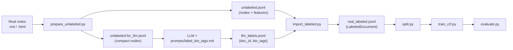

# Labeling Real Notes with an LLM

This document describes the real-notes labeling pipeline: how existing Markdown
or HTML math notes become CRF training data with the help of an LLM, and which
invariants keep that data compatible with the deterministic Rust core.

The pipeline is strictly offline and dev-only. Nothing here ships to end users;
the resulting `LabeledDocument` JSONL is consumed by the existing
`split.py` → `train_crf.py` → `evaluate.py` flywheel.

---

## 1. Why This Exists

The synthetic corpus in `dataset_gen.py` is clean and bilingual, but it cannot
cover every real-world formatting quirk: OCR noise, inconsistent headings,
keywordless proofs, mixed Persian/English exposition, and imported HTML.
Real notes provide that distribution, but they have no BIO ground truth.

The pipeline solves this by:

1. Extracting the exact AST and `NodeFeatures` the CRF sees.
2. Asking an LLM to label only the node text and structure, not the verbose
   feature vectors.
3. Validating every label against the same structural rules the Rust core
   enforces before the data is allowed into training.

---

## 2. End-to-End Flow



### Step 1 — Extract unlabeled documents

```bash
cd ml
uv run python -m mathia_ml.prepare_unlabeled ../sample-data/notes \
    --output data/unlabeled.jsonl \
    --llm-input data/unlabeled_for_llm.jsonl \
    --config ../scoring.toml
```

`prepare_unlabeled.py` accepts a single supported file or a directory
(`--recursive` for nested folders). It runs `mathia dump-features` for every
file, so the output matches the CRF schema exactly.

For HTML inputs, the CLI detects `.html` / `.htm` by extension or content and
uses `math_core::dump_features_from_html`, which:

1. Cleans the document with `clean_html::analyze_html_detailed`.
2. Renders it back to Markdown with `markdown::render`.
3. Runs the normal `dump_features_with_overrides` path.

Each full record is an `UnlabeledDocument`:

```json
{
  "doc_id": "rolle_1a2b3c4d",
  "language": "en",
  "title": "Rolle's Theorem",
  "nodes": [{"index": 0, "kind": "heading", "flat_text": "Rolle's Theorem", "char_len": 16, "env_span": null}],
  "features": [{"lead": null, "mentions": [], "math_density": 0.0}],
  "bio_tags": null,
  "metadata": {
    "source": "real_notes",
    "source_file": "../sample-data/notes/rolle.md",
    "source_format": "md"
  }
}
```

The compact LLM input drops `features` and keeps only what the labeler needs:

```json
{"doc_id": "rolle_1a2b3c4d", "language": "en", "title": "Rolle's Theorem",
 "nodes": [{"index": 0, "kind": "heading", "flat_text": "Rolle's Theorem", "env_span": null}]}
```

`doc_id` is deterministic: sanitized filename stem plus the first 8 hex
characters of the SHA-256 of the file content. `language` is `"fa"` when
Persian characters are at least 5% of non-whitespace text (or at least five
characters); otherwise `"en"`. `title` is the first heading, falling back to
the filename stem.

### Step 2 — Label with an LLM

Give the model:

- `ml/prompts/label_bio_tags.md`
- `data/unlabeled_for_llm.jsonl`

The prompt defines the 25-tag vocabulary (`O` plus `B-`/`I-` for 12 block
types), the BIO transition rules, non-openable node kinds, reference-vs-block
distinctions, and bilingual few-shot examples. The model must return only
compact JSONL:

```json
{"doc_id": "rolle_1a2b3c4d", "bio_tags": ["O", "B-THEOREM", "I-THEOREM", "B-PROOF", "O"]}
```

### Step 3 — Validate and merge

```bash
uv run python -m mathia_ml.import_labeled \
    --unlabeled data/unlabeled.jsonl \
    --labels data/llm_labels.jsonl \
    --output data/real_labeled.jsonl
```

`import_labeled.py` parses JSONL, JSON arrays, or fenced JSON/JSONL, and accepts
both compact label records and full `LabeledDocument` records. It then enforces:

- Every labeled `doc_id` exists in `--unlabeled`.
- `len(bio_tags) == len(nodes)`.
- Every tag is in the 25-tag vocabulary.
- `I-X` follows only `B-X` or `I-X`.
- `B-*` never appears on `display_math`, `table`, `code`, `rule`, `list`, or
  `other`.

Errors include the `doc_id` and `node.index`. By default any violation aborts
the import; `--skip-invalid` drops bad documents and continues. Missing labels
for unlabeled documents are reported as warnings.

On success it writes full `LabeledDocument` JSONL and prints a summary:
documents imported, total nodes, and span counts per block type.

### Step 4 — Train and evaluate

```bash
uv run python -m mathia_ml.split --input data/real_labeled.jsonl --output-dir data/
uv run python -m mathia_ml.train_crf --train-path data/train.jsonl --val-path data/val.jsonl
uv run python -m mathia_ml.evaluate --test-path data/test.jsonl
```

Real notes can be mixed with synthetic documents before splitting; no schema
conversion is needed.

---

## 3. Code Map

| Component | Responsibility |
|---|---|
| `crates/math-core/src/features.rs` | `dump_features_from_html` cleans HTML, renders Markdown, and dumps the CRF AST/features. |
| `crates/mathia-cli/src/main.rs` | `dump-features` accepts Markdown or HTML and emits pretty JSON. |
| `ml/src/mathia_ml/schema.py` | `UnlabeledDocument` mirrors `LabeledDocument` with optional `bio_tags`. |
| `ml/src/mathia_ml/dataset_gen.py` | Shared `run_dump_features`; now supports `.html` temp files and `--config`. |
| `ml/src/mathia_ml/prepare_unlabeled.py` | File discovery, language/title/doc_id extraction, full + compact JSONL. |
| `ml/prompts/label_bio_tags.md` | Self-contained LLM labeling prompt with rules and examples. |
| `ml/src/mathia_ml/import_labeled.py` | Forgiving parsing, invariant validation, merge, summary. |
| `ml/tests/test_real_notes_pipeline.py` | Markdown/HTML extraction and validation/error tests. |

---

## 4. Invariants and Failure Modes

- **Schema parity is the point.** Never hand-edit `nodes` or `features` after
  extraction. If the Rust feature extractor changes, re-run
  `prepare_unlabeled.py` rather than patching JSONL.
- **Labels never create nodes.** The merge step copies `nodes` and `features`
  from the unlabeled record and only attaches `bio_tags`.
- **The LLM is untrusted input.** Treat every label record as suspect until
  `import_labeled.py` validates it.
- **HTML is converted, not bypassed.** HTML features come from the rendered
  Markdown, so they match the Markdown CRF path.
- **Determinism.** File ordering, `doc_id`, and language detection are
  deterministic; rerunning extraction on unchanged files produces the same
  `doc_id`s.

---

## 5. Tests

```bash
cargo test --workspace
cd ml && uv run pytest
```

The Rust tests cover HTML `dump-features` output. The Python tests cover:

- Markdown and HTML extraction, full and compact JSONL.
- Default sibling `*.for_llm.jsonl` naming and Persian detection.
- Happy-path merge from fenced compact labels.
- Length mismatch, unknown tag, illegal `I-` transition, and `B-*` on
  `display_math`.
- `--skip-invalid` behavior.
